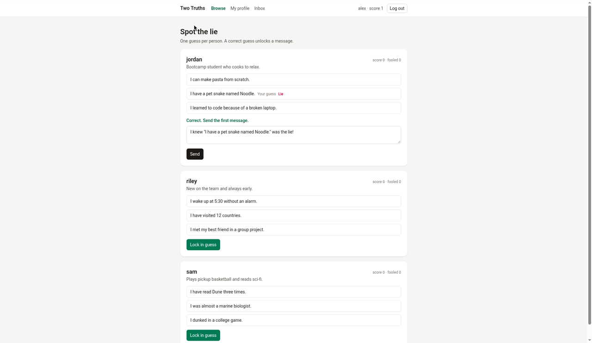
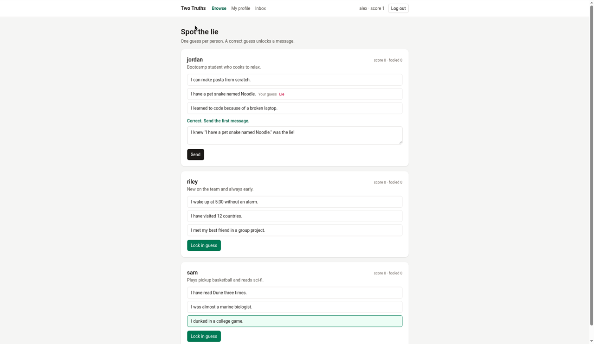

# TwoTruths

Online profiles are bland, and first messages get ignored. TwoTruths is an icebreaker: you post two truths and a lie, other people guess which statement is the lie, and a correct guess unlocks messaging.

## Features

- Sign up, log in, and log out with session auth. Passwords are hashed with bcrypt.
- Write, edit, and delete your three statements. Exactly one must be the lie. The set locks once someone guesses.
- Browse profiles and guess once per profile. You cannot guess your own.
- A score counts correct guesses. A "fooled" count tracks wrong guesses against your profile.
- An inbox where messaging unlocks after a correct guess in either direction.

Statements are created and deleted as a whole set of three (`DELETE /api/statements`). A single-statement delete returns 400.

## 3D cube view

The cube is the whole site. Front is the statements (or the log-in form when signed out), left is the player list, right is the inbox (or sign up), and back is your profile. Top and bottom stay blank. There is no navigation bar in this view: the corner shows the title, and once you are signed in, your name, score, and Log out. Tapping a statement only highlights it; "Lock in guess" sends it. A correct guess celebrates and turns to the inbox. A wrong guess shakes the cube, then turns it to the player list. A bad login shakes the cube. A good login or sign-up nods, then turns to the statements.

The flat pages and the top navigation are only the fallback. That happens when reduced motion is on (unless you opt in), the screen is narrow or the pointer is coarse, WebGL is missing, the cube fails to load, or you choose "Use flat view". A line above the flat content names which of those it is. Reduced motion and narrow or touch screens can press "Show 3D cube anyway"; that choice is saved in the browser. Reduced motion then uses quick turns, without the jump or the shake. Missing WebGL and a failed load stay on the flat pages.

```bash
cd client && npm test
cd client && npm run build && npx oxlint
cd server && pytest
```

## Screenshots







TODO: add a screenshot of the 3D cube view.

## Tech stack

Flask, SQLAlchemy, Flask-Migrate, Marshmallow, and Flask-Bcrypt on the server, with SQLite. React, Vite, React Router, and Tailwind on the client.

## Data model

- **User** — account, bio, and score.
- **Statement** — belongs to a user. Text, plus whether it is the lie.
- **Guess** — guesser pointing at a profile user, and the statement they picked. Also the user-to-user many-to-many join, unique per pair.
- **Message** — sender pointing at a recipient.

## Setup

Copy the environment file:

```bash
cp .env.example .env
```

Start the API (port 5555):

```bash
cd server && python3 -m venv .venv && source .venv/bin/activate && pip install -r requirements.txt && flask db upgrade && python seed.py && flask run
```

In a second terminal, start the client, then open http://localhost:5173:

```bash
cd client && npm install && npm run dev
```

Demo logins: alex, jordan, sam, and riley, all with password `password123`.

Run the tests:

```bash
cd server && pytest
```

## API

Routes below are the ones defined in `server/app.py`. Auth means a logged-in session.

| Method | Path | Auth | Purpose |
| --- | --- | --- | --- |
| POST | `/api/signup` | No | Create an account and start a session. |
| POST | `/api/login` | No | Log in and start a session. |
| DELETE | `/api/logout` | No | End the current session. |
| GET | `/api/check_session` | No | Return the logged-in user, or `{"user": null}` when logged out. |
| GET | `/api/users` | Yes | List other profiles that are ready to guess. |
| GET | `/api/statements` | Yes | List your statements, including which one is the lie. |
| POST | `/api/statements` | Yes | Create your set of three statements. |
| PATCH | `/api/statements/<id>` | Yes | Edit one of your statements, unless the set is locked. |
| DELETE | `/api/statements/<id>` | Yes | Refuse a single delete; a profile needs exactly three statements. |
| DELETE | `/api/statements` | Yes | Delete your whole set, unless someone has already guessed. |
| POST | `/api/guesses` | Yes | Guess once which statement on a profile is the lie. |
| GET | `/api/messages` | Yes | List messages you sent or received. |
| POST | `/api/messages` | Yes | Send a message after a correct guess in either direction. |

Author: Jose Rayos
