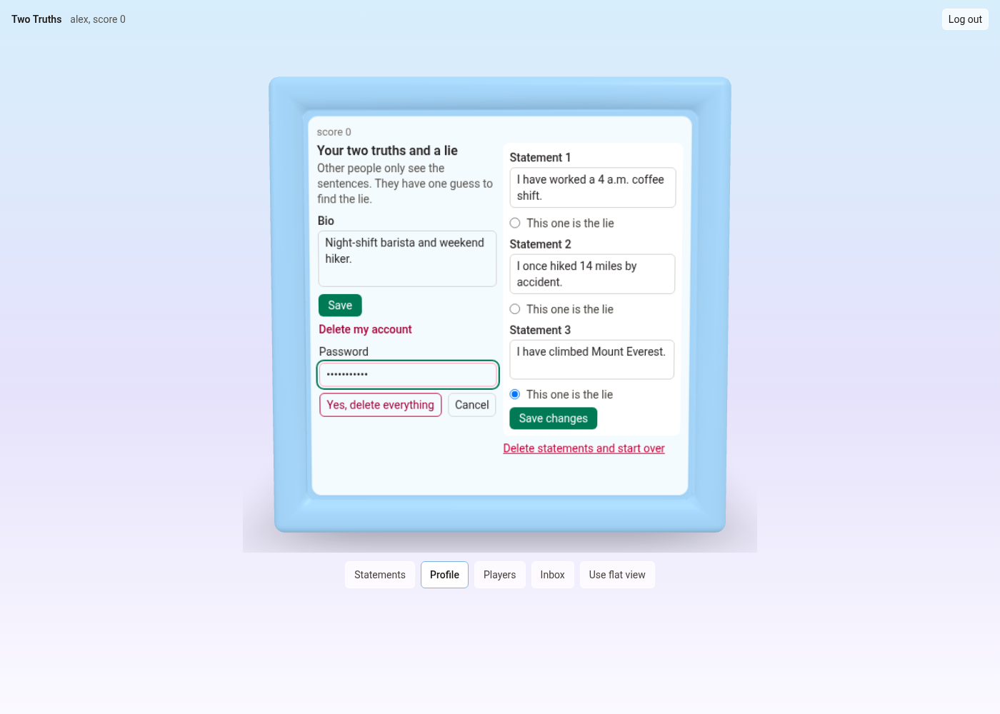
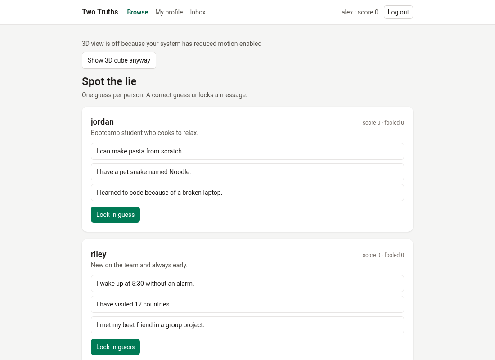

# TwoTruths

TwoTruths is a guessing game. Each player posts two truths and one lie, and other people try to spot the lie.

It is for friends and classmates. This is a capstone Project 2, built so people can start a conversation with something fun instead of a blank message box.

You post three statements. Someone else guesses which one is the lie. A correct guess unlocks messaging between the two of you, and scores track who found the lie and who was fooled. The interface is a 3D cube, with the same game on flat pages when 3D is off.

The server is Flask, SQLAlchemy, and SQLite. The client is React, Vite, and Tailwind. The cube is three.js.

## Quick start

```
Needs: Python 3.10+ and Node 20.19+ or 22.12+.
npm run setup
npm start
Open http://127.0.0.1:5173
```

Demo logins: alex / password123, and jordan, sam, and riley with the same password.

## Features

- Sign up, log in, and log out with a server session. Passwords are hashed with bcrypt.
- Usernames are case-insensitive. `Alex` and `alex` are the same account. Login accepts either spelling and returns the spelling that was saved.
- Edit your bio, or clear it. Delete your own account by confirming the password. That removes your statements, guesses, and messages, and recounts scores that depended on you.
- Post exactly three statements, with one lie. Read them, edit one, or delete the whole set. There is no single-statement delete.
- One guess per other profile. You cannot guess yourself. A correct guess scores a point and unlocks messages. A wrong guess raises that profile's fooled count. The set locks after any guess.
- Message only after a correct guess, in either direction. The first box is filled with `I knew "<the lie>" was the lie!`
- The inbox reloads every 20 seconds while it is on screen and the browser tab is visible, and again when you open it.
- Login and signup are rate limited. Failures return JSON `{"error": "..."}`, including 429.
- The site is a 3D cube. Flat pages are the fallback.

## Screenshots

**Log in face**


**Front face with statements and Lock in guess**


**Correct guess**


**Inbox face**


**Players face**


**Profile face**


**Delete account on the profile face**



**Wrong guess**


**Flat fallback view (reduced motion, small screens, or no WebGL)**



## How the game works

1. You post two truths and a lie.
2. Someone else picks a statement and presses Lock in guess. They get one try.
3. A correct guess scores a point, turns the cube to the inbox, and opens messages for both people. The box starts with `I knew "<the lie>" was the lie!`
4. A wrong guess shakes the cube, turns it to the player list, and adds one to that profile's fooled count. Messaging stays closed.
5. After any guess, that set of statements is locked.
6. Cube faces: front is statements (or log in), left is players, right is inbox (or sign up), back is your profile.

## Tech stack

Flask, SQLAlchemy, Flask-Migrate, Marshmallow, and Flask-Bcrypt. SQLite for local data. React, Vite, React Router, and Tailwind on the client. The cube uses three.js, React Three Fiber, drei, and GSAP. The production process in the Dockerfile and `render.yaml` is gunicorn. `psycopg2-binary` is installed so a PostgreSQL URL can be used; the tests here use SQLite only.

## Project structure

```
package.json                 npm run setup, npm start, npm test, npm run e2e
.env.example                 commented environment variables
Dockerfile                   build the client, then run gunicorn
Procfile                     migrate, then gunicorn
render.yaml                  Render blueprint
.dockerignore                leaves secrets and local builds out of the image
scripts/setup.js             venv, packages, migrate, seed if the database is empty
scripts/start.js             Flask on 5555 and Vite on 5173
scripts/test.js              pytest, then the client tests
scripts/common.js            shared paths and process helpers
client/                      React app
client/src/main.jsx          starts React
client/src/App.jsx           cube or flat routes
client/src/api.js            calls the Flask API
client/src/AuthContext.jsx   the signed-in user
client/src/pages/            Login, Signup, Browse, Inbox
client/src/components/       forms, profile editor, inbox, FirstMessageForm.jsx
client/src/cube/             the 3D cube; gameContext.jsx holds the play state
client/public/               cube model and the Draco decoder
server/app.py                API routes
server/config.py             secret, database, cookie, CORS, proxy
server/models.py             users, statements, guesses, messages
server/schemas.py            JSON shapes (the lie stays off public profiles)
server/validation.py         username, password, bio, text, and id checks
server/game.py               statement, guess, and message rules
server/limiter.py            login and signup rate limits
server/errors.py             JSON error bodies
server/client_files.py       serves client/dist when that build exists
server/seed.py               demo accounts
server/.flaskenv             local Flask app, debug, host, and port
server/requirements.txt      production Python packages
server/requirements-dev.txt  install this for development and tests
server/tests/                pytest
server/migrations/           Flask-Migrate revisions
docs/screenshots/            pictures above
e2e/regress.js               browser regression (Playwright is optional)
e2e/vite.config.mjs          Vite for that script, on its own ports
e2e/README.md                how to run the browser regression
postman/                     TwoTruths.postman_collection.json
```

## API routes

Every path is under `/api`. A logged-out call to a protected route is 401 `{"error": ...}`. A bad JSON body is 400 with the same shape. Deeply nested JSON is 400. Handled 404, 405, 413, and 500 responses are JSON too. A 500 says "Something went wrong." and does not include the exception text.

| Method | Path | Auth | What it does | Status codes |
| --- | --- | --- | --- | --- |
| GET | /api/health | no | `{"ok": true}` | 200 |
| POST | /api/signup | no | Create an account and log in. Names ignore case | 201, 400, 409, 413, 429 |
| POST | /api/login | no | Log in. Any case matches; the saved spelling is returned | 200, 400, 401, 413, 429 |
| DELETE | /api/logout | no | Clear the session | 200 |
| GET | /api/check_session | no | Current user, or `{"user": null}` | 200 |
| GET | /api/users | yes | Other finished profiles. `is_lie` stays hidden until you guess | 200, 401 |
| PATCH | /api/profile | yes | Set or clear your bio. Empty text clears it. Limit 160 | 200, 400, 401 |
| DELETE | /api/account | yes | Delete your account. The body must include your password | 200, 400, 401, 429 |
| GET | /api/statements | yes | Your statements, including which one is the lie | 200, 401 |
| POST | /api/statements | yes | Save a new set of exactly three, with one lie | 201, 400, 401 |
| PATCH | /api/statements/`<id>` | yes | Edit one statement you own, before anyone has guessed | 200, 400, 401, 403, 404 |
| DELETE | /api/statements | yes | Delete the whole set, if nobody has guessed | 200, 401, 403 |
| POST | /api/guesses | yes | One guess at someone else's lie | 201, 400, 401, 403, 404, 409 |
| GET | /api/messages | yes | Messages you sent or received | 200, 401 |
| POST | /api/messages | yes | Send a message after a correct guess in either direction | 201, 400, 401, 403, 404, 413 |

There is no `DELETE /api/statements/<id>` route. A normal id on that path is 405 `{"error": "Method not allowed."}`. An id that is zero, negative, or 2^63 or larger is 404 in a URL and 400 in a JSON body. A digit string longer than 19 characters is also 404 in the URL, before it is parsed. A request body over 64 KiB is 413 `{"error": "Request is too large."}` whether the request sends a Content-Length header or a chunked body. Unknown `/api` paths, including `/api//users`, are JSON 404. Slashes are not merged, so the double slash is not redirected to `/api/users`. When Flask is serving the built client, a missing `/assets/*.js` file (any missing file under `assets/` whose name has an extension) is JSON 404, not `index.html`. A lone surrogate, or other text that cannot be encoded as UTF-8, is 400.

Login: after five failed attempts for the same username and IP within 60 seconds, the next try returns 429 with a `Retry-After` header (whole seconds, from 1 to 60). After twenty failed logins from one IP, the next try returns 429, even when the username is new. A successful login clears the count for that username on that IP. It does not clear the per-IP count. A wrong password on `DELETE /api/account` counts as a failed login.

Signup: after ten attempts from one IP within 60 seconds, the next try returns 429 with `Retry-After`. Attempts that fail validation count. The counts are kept in memory for this process.

## Data model

- **User** — username, bcrypt password hash, bio, score. The saved username keeps the spelling you typed. A unique index on the lowercased name blocks `Alex` when `alex` exists. `fooled_count` is the number of wrong guesses on this profile. It is counted, not stored. `score` is stored, and it is counted again from remaining correct guesses when a related account is deleted.
- **Statement** — text and `is_lie`, owned by one user. A finished profile has three, exactly one of them the lie.
- **Guess** — guesser, profile, and the statement they picked. Unique per guesser and profile, so it is also the link between two users.
- **Message** — sender, recipient, and body. Allowed only after a correct guess between that pair.

## Configuration

Copying `.env.example` is optional. `npm run setup` writes `.env` with a random `SECRET_KEY` when the file is missing, when it has no `SECRET_KEY` line, or when the last `SECRET_KEY` line is empty. If the file has several `SECRET_KEY` lines, the last one is the value that is loaded, and only an empty last line is replaced.

- `SECRET_KEY` — required when `FLASK_DEBUG` is off. With debug on and no key, the server uses a dev-only value. With debug off and no key, it stops and tells you to run `npm run setup`.
- `DATABASE_URI` — optional. The default is a SQLite file at `server/instance/app.db`. `DATABASE_URL` is used when `DATABASE_URI` is unset (Render and Heroku set that name). A `postgres://` URL is rewritten to `postgresql://`, and `postgres+psycopg2://` is rewritten to `postgresql+psycopg2://`. `psycopg2-binary` is installed, so a PostgreSQL URL is accepted. Only SQLite is tested here.
- `FLASK_DEBUG` — `server/.flaskenv` and `npm start` turn it on for local use. Do not leave it on for a public server. Values `1`, `true`, and `yes` are on. Unset or `0` is off.
- `CORS_ORIGINS` — optional, comma-separated. Each entry has surrounding whitespace and a trailing slash removed. The default is `http://localhost:5173` and `http://127.0.0.1:5173`. Local `npm start` proxies `/api` through Vite, so the browser stays on one origin. CORS matters when a page calls the API from somewhere else.
- `TRUST_PROXY` — set to `1` only behind one reverse proxy, so login limits use `X-Forwarded-For`. Leave it unset on your own computer. `render.yaml` sets it. The Docker image does not. Set it yourself when a proxy is in front.
- `CLIENT_DIST` — optional path to the built React files. The default is `client/dist`. Leave it unset in development.
- Session cookie — HttpOnly, SameSite=Lax, and Secure when debug is off. Local http login keeps working because `npm start` turns debug on.
- Login and signup limits — in memory for this process. See the API section for the numbers. A restart clears them.

## Deploy

Written to deploy on Render or with Docker; not yet deployed. Render has not been run on this machine. Docker has never been built or run here.

Live demo: not deployed yet.

In production, Flask serves `client/dist` when that folder contains `index.html` (`server/client_files.py`). Pages other than `/api` get `index.html`, so the client router can load. `GET /api/health` stays JSON. Files under `assets/` are cached for a year (`Cache-Control: public, max-age=31536000, immutable`). The production build puts the hashed JS and CSS there. `index.html`, including the copy sent for client routes, is `Cache-Control: no-cache`. A missing file under `assets/` whose name has an extension is JSON 404. Local `npm start` does not build `client/dist`; Vite serves the site on port 5173 and proxies `/api` to port 5555.

A public process needs `SECRET_KEY`. Set `FLASK_DEBUG` off. Set `TRUST_PROXY=1` when a proxy is in front. Render sets `PORT`. For data you want to keep, set `DATABASE_URI` (or `DATABASE_URL`) to a PostgreSQL URL. `CORS_ORIGINS` and `CLIENT_DIST` can stay unset when Flask serves the built client on the same origin.

The session cookie is Secure when debug is off, so a browser keeps the login only over HTTPS.

### Render

`render.yaml` is a blueprint for one Python web service named `twotruths`.

- Build: `pip install -r server/requirements.txt && npm --prefix client ci && npm --prefix client run build`
- Start: `cd server && flask db upgrade && gunicorn app:app --bind 0.0.0.0:$PORT`
- Health check: `/api/health`
- Python is pinned to 3.12.8 (`PYTHON_VERSION`)
- Env in the file: `PYTHON_VERSION=3.12.8`, `SECRET_KEY` (generated), `FLASK_DEBUG=0`, `TRUST_PROXY=1`

The blueprint does not create a database and does not seed demo users. The default database is the SQLite file `server/instance/app.db`. On a free Render instance that disk is ephemeral, so use a PostgreSQL `DATABASE_URI` if the accounts should survive a restart. `postgres://` is accepted and rewritten to `postgresql://`. `postgres+psycopg2://` is rewritten to `postgresql+psycopg2://`.

Demo data is optional. From the server directory on the host: `python seed.py --if-empty`. That inserts alex, jordan, sam, and riley only when the database has no users.

### Docker

The Dockerfile builds the client with Node 22. That stage installs packages with `npm ci`, then runs `npm run build`. The API stage uses Python 3.12 and installs `server/requirements.txt`. The image runs as the non-root user `appuser`, has a HEALTHCHECK that requests `/api/health`, and sets `FLASK_DEBUG=0`. It does not set `TRUST_PROXY`. Only `render.yaml` sets that. Set `TRUST_PROXY=1` yourself when a proxy is in front. The process listens on `PORT`, or 8000 if `PORT` is unset. `SECRET_KEY` is required.

```
docker build -t twotruths .
docker run --rm -p 5555:5555 -e PORT=5555 -e SECRET_KEY=replace-with-a-long-random-string twotruths
```

`GET http://127.0.0.1:5555/api/health` is the check that does not need a cookie. The image also runs `flask db upgrade` before gunicorn. It does not seed users. Docker has never been built or run here. Because debug is off, the session cookie is Secure, so a browser on plain `http://127.0.0.1:5555` will not keep a login.

## Running the tests

From the repo root, `npm test` runs the server suite, then the client suite. Run `npm run setup` first so the virtualenv and `client/node_modules` exist. Setup installs `server/requirements-dev.txt` for development and tests. That file includes `server/requirements.txt` and adds pytest. Docker and Render install `server/requirements.txt` only.

Server, from `server/`: `.venv/bin/pytest`. Windows: `.venv\Scripts\python -m pytest`.

- `test_rules.py` — signup, statements, guesses, messages, and who is allowed
- `test_account.py` — bio edits and deleting an account
- `test_usernames.py` — case-insensitive names and the migration
- `test_bad_input.py` — bad JSON and wrong field types
- `test_ids.py` — ids that are zero, negative, or too large
- `test_login_limit.py` — failed logins, then 429
- `test_limiter.py` — the time window, per-IP caps, signup 429, and `TRUST_PROXY`
- `test_deploy.py` — health, serving `client/dist`, the `postgres://` rewrite, and JSON errors
- `test_setup_env.py` — writing `SECRET_KEY`
- `test_reset_guesses.py` — `seed.py --guesses`

Client, from `client/`: `npx vitest run` (the same command as `npm test` in that folder). Those files cover the login, signup, and browse pages, the profile editor, the cube, and accessibility. `npm run build` builds the client. `npx oxlint` lints it.

The API collection is `postman/TwoTruths.postman_collection.json`. With the API on port 5555: `npx newman run postman/TwoTruths.postman_collection.json`. See Postman below for the rate-limit note.

`npm run e2e` runs the browser regression in `e2e/regress.js`. It is not part of `npm test`. Playwright is not a dependency. Install it without saving it (`npm i --no-save playwright` inside `e2e/`, or set `NODE_PATH` to a `node_modules` that already contains it) and have Google Chrome installed. If Playwright is missing, the script prints `SKIP` and exits 0. It launches Chrome headless (`PLAYWRIGHT_CHANNEL`, default `chrome`) with `--use-gl=swiftshader` and `--enable-unsafe-swiftshader`.

The script does not open `server/instance/app.db`. It creates a temporary SQLite file, runs `flask db upgrade` and `python seed.py` with `DATABASE_URI` set to that file, and starts its own API and Vite. Defaults are API port 5565 (`E2E_API_PORT`) and Vite port 5183 (`E2E_WEB_PORT`). Ports 5555 and 5173 are left alone. The temp directory and those processes are removed when the script exits, including on SIGINT and SIGTERM. A leftover listener on 5565 or 5183 is stopped only when it is a previous run of this script. Details are in `e2e/README.md`.

It checks login and the four cube faces, a wrong guess and a correct guess, a message that shows in the thread without a reload, another user's message arriving on the inbox's 20 second poll (the script moves the page clock forward 20 seconds instead of waiting that out on the wall clock), a bio that is still there after reload, confirming and cancelling statement deletion, deleting a throwaway account, the flat view (reduced motion, the flat-view button, and a 600px wide window), WebGL context loss and the Reload page button, a signup of `Alex` while `alex` exists, and a 429 after six bad logins. It also checks that the login face, the sign-up face, and every logged-in face render fully at 1366×768, 1024×768, 1536×864, 1280×720, 1280×800, 1400×1000, and 1024×700. On the profile face at 1280×800 and 1400×1000, the face does not scroll, and the statement fields and the bio are not cut off. A wrong password must show "Username or password is incorrect." and stay on the login screen. The taken username must show "That username is taken." and stay on the sign-up screen. The listened flow logs in, visits each face, logs out, logs in again, and logs out back to the login face. The console may log error-level failed-resource lines only for 401 (wrong password on login), 409 (signup when the name is taken), and 429 (the sixth bad login). Any console message containing "synchronously unmount" fails the run. On this machine a full run takes about 4 minutes (230 to 260 seconds over five runs in a row).

## Postman

Import `postman/TwoTruths.postman_collection.json`. The collection variable `baseUrl` is `http://127.0.0.1:5555`. Start the API, then run the collection. Postman and newman keep the session cookie.

The collection signs up its own users (`a`, `b`, and `c` plus a timestamp). It does not log in as alex, jordan, sam, or riley. The account it deletes is the throwaway `c` user. You can run it twice after `cd server && .venv/bin/python seed.py`.

It sends one bad login and one bad account-delete password, on different usernames, so it stays under the limit of 5 failures per username and IP per 60 seconds. Signup allows 10 attempts per IP per 60 seconds, and one run sends 4 (two new users, one case-conflict, one throwaway). Two runs in the same minute stay under that cap. A third run in that minute can get 429.

## Security notes

- Passwords are hashed with bcrypt. The hash is not included in JSON. A password over 72 bytes is rejected before bcrypt sees it.
- The session cookie is HttpOnly and SameSite=Lax. It is Secure when `FLASK_DEBUG` is off. Logout and account deletion clear the session.
- You can change only your own statements. Someone else's statement is 404. Guessing your own profile is 403. Messaging yourself, or messaging before a correct guess, is 403. Editing or deleting a set after a guess is 403. A missing profile or recipient is 404.
- Login and signup are rate limited. A wrong password on account delete counts as a failed login. The numbers are in the API section.
- Usernames, passwords, bios, statements, messages, and ids are checked before they are saved. Bios are at most 160 characters, statements 200, messages 500. Usernames are 3–20 letters, numbers, or underscores. Passwords are at least 6 characters.
- Not done: there is no email verification and no password reset. The rate limiter is in memory for this process. A restart clears it, and another process does not share the counts.

## Troubleshooting

- A flat page instead of the cube means reduced motion is on, the window is 640px or narrower, the pointer is coarse, WebGL is off, the cube failed to load, the browser lost the graphics context, or a flat choice was saved. The note on the page says which. Narrow, coarse, and reduced-motion screens get "Show 3D cube anyway". A saved flat choice gets "Use 3D cube". The cube has "Use flat view". A lost graphics context gets "Reload page".
- If port 5555 or 5173 is taken, stop that program and run `npm start` again (macOS or Linux: `lsof -i :5555`, Windows: `netstat -ano | findstr :5555`).
- If setup says Python or Node is missing or too old, install Python 3.10+ and Node.js 20.19+ or 22.12+. Setup also accepts any Node major version above 22. Node 21 is rejected.
- To reset demo data, `cd server` and run `.venv/bin/python seed.py` (Windows: `.venv\Scripts\python seed.py`). That replaces every account. `--if-empty` does that only when there are no users. `--guesses` clears only guesses, messages, and scores.
- Five bad passwords for one username from your machine lock that login for up to a minute (429). Wait, or restart the API, which clears the in-memory counts.

## Design decisions

- A statement is deleted only with the whole set. There is no single-statement route, so that call is 405. One or two leftover sentences would not be a profile.
- A guess locks the set. Editing the lie later would change a result someone already saw.
- The same rules are checked on the server. The cube and the flat pages cannot skip them.
- The cube falls back to the flat pages when 3D is unavailable, declined, or the browser drops the graphics context. The game is the same either way.
- Usernames compare case-insensitively, and the typed spelling is what gets stored.
