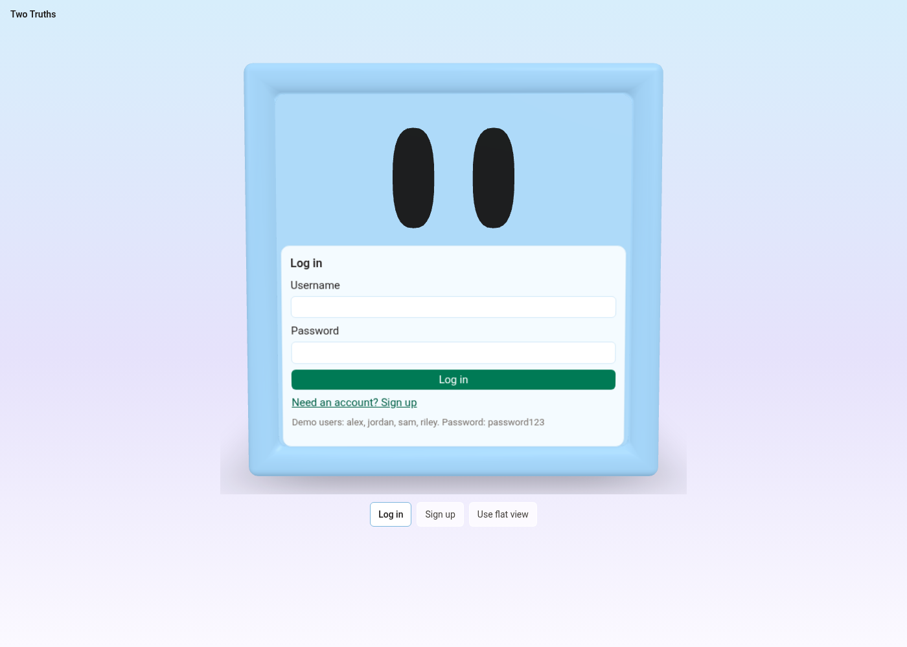
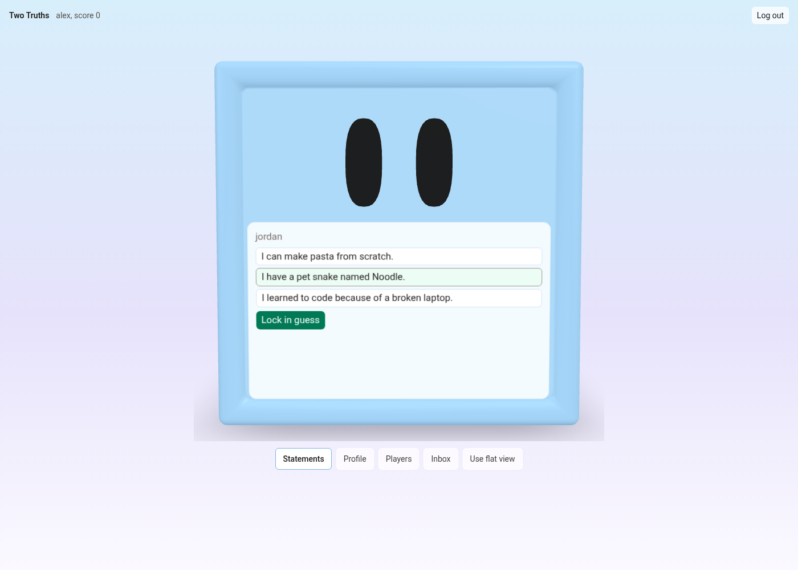
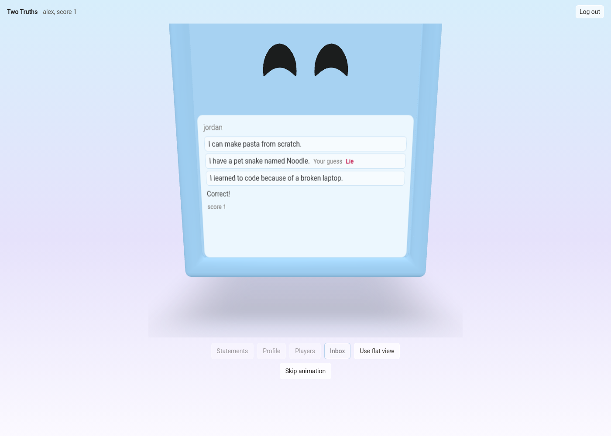
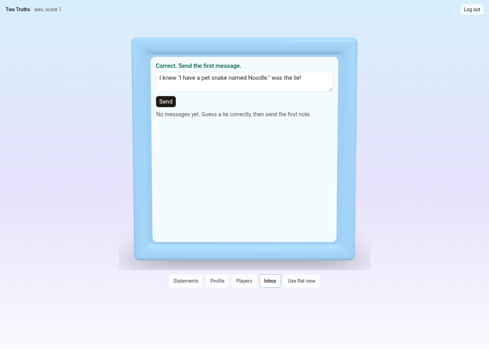
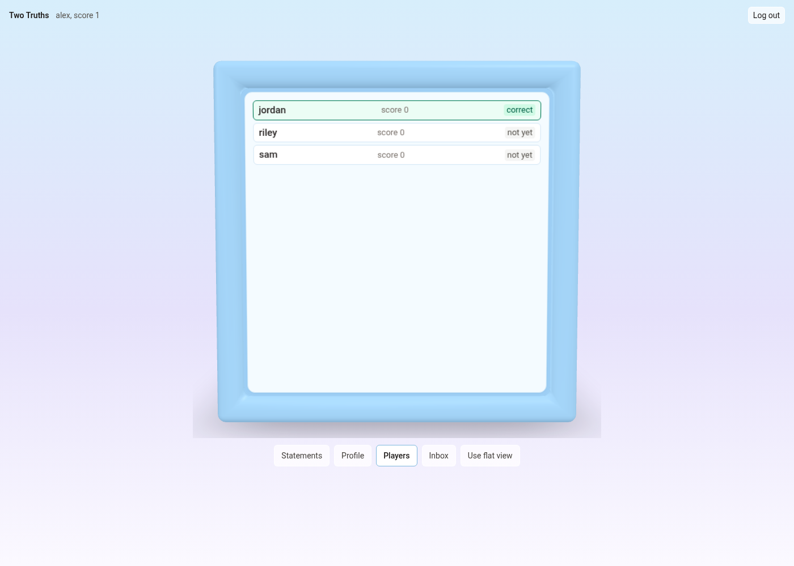
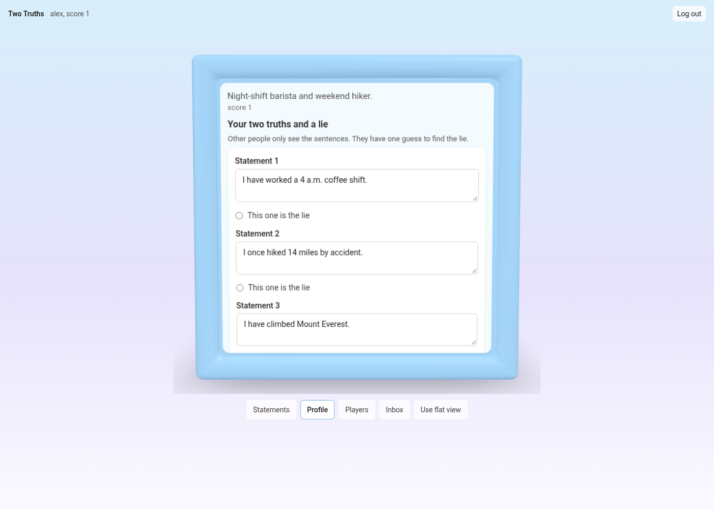
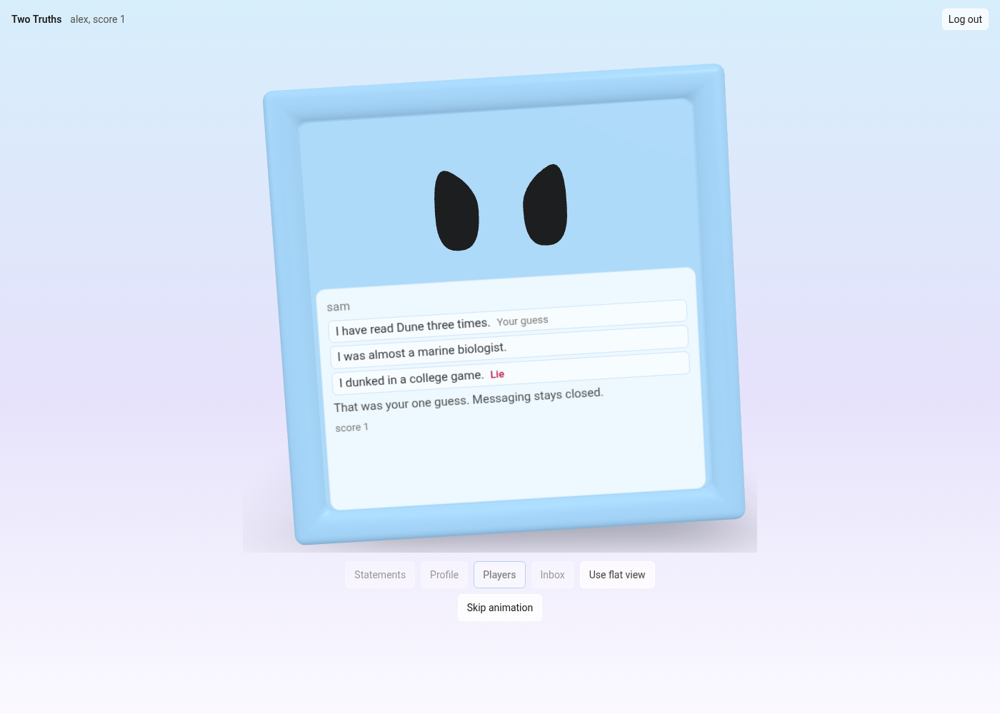

# TwoTruths

Post two truths and a lie, let other people guess the lie, and unlock a message when they get it right.

## Quick start

```
Needs: Python 3.10+ and Node 20.19+ or 22.12+.
npm run setup      # installs everything and creates demo data
npm start          # runs the API and the website
Open http://127.0.0.1:5173 and log in with alex / password123
```

Other demo logins are jordan, sam, and riley, with the same password.

## Features

- Sign up, log in, and log out with session auth. Passwords are hashed.
- The whole site is a 3D cube. Flat pages are only a fallback.
- Guess once per profile. You cannot guess your own.
- A correct guess unlocks messaging between that pair.
- A score counts correct guesses. A fooled count tracks wrong guesses on your profile.
- Statements lock after a guess, so the set can no longer be edited or deleted.

## Screenshots

**Log in face**



**Front face with statements and Lock in guess**



**Correct guess**



**Inbox face**



**Players face**



**Profile face**



**Wrong guess**



## How the game works

1. You post two truths and a lie.
2. Others pick the lie and press Lock in guess.
3. Each person gets one guess per profile.
4. A correct guess scores a point, spins the cube to your inbox, and unlocks messaging in that pair.
5. A wrong guess shakes the cube and spins it to the player list. Messaging stays closed, and that profile's fooled count goes up.
6. Statements lock once anyone has guessed.
7. Cube faces: Front is statements, Left is players, Right is inbox, and Back is your profile.

## Tech stack

Flask, SQLAlchemy, Flask-Migrate, Marshmallow, and Flask-Bcrypt on the server, with SQLite.
React, Vite, React Router, and Tailwind on the client.

## Data model

- **User** — account, bio, and score.
- **Statement** — belongs to a user. Text, plus whether it is the lie.
- **Guess** — guesser pointing at a profile user, and the statement they picked. Also the user-to-user many-to-many join, unique per pair.
- **Message** — sender pointing at a recipient.

## Code layout

```
package.json         npm run setup, npm start, and npm test
scripts/             setup.js, start.js, test.js, and common.js
client/src/
  main.jsx           starts React
  App.jsx            flat routes, and the switch to the cube
  api.js             calls the Flask API
  AuthContext.jsx    who is logged in
  pages/             Login, Signup, Browse, Inbox
  components/        nav, forms, profile editor, inbox, shared hooks
  cube/              the 3D cube, its animations, and the flat-view decision
server/
  app.py             API routes
  models.py          database tables
  schemas.py         JSON shapes
  config.py          Flask setup
  seed.py            demo accounts, --if-empty, or --guesses
  tests/             the game rules
```

## Running tests

From the repo root, `npm test` runs the server tests and the client tests.

Server only, from `server/`: `.venv/bin/python -m pytest` (Windows: `.venv\Scripts\python -m pytest`).

Client only, from `client/`: `npx vitest run`. The same folder also has `npm run build` and `npx oxlint`.

## Troubleshooting

- A flat page instead of the cube means Reduce motion is on, the window is narrower than 640px, the screen is a touch screen, WebGL or hardware acceleration is off, or a flat choice was saved; use "Show 3D cube anyway" or the "Use 3D view" option ("Use 3D cube").
- If port 5555 or 5173 is already in use, stop that program and run `npm start` again (macOS or Linux: `lsof -i :5555`, Windows: `netstat -ano | findstr :5555`).
- If setup says Python or Node is missing or too old, install Python 3.10+ and Node.js 20.19+ or 22.12+, then run `npm run setup` again.
- To reset the demo data, `cd server` and run `.venv/bin/python seed.py` (Windows: `.venv\Scripts\python seed.py`).
- To reset only guesses, messages, and scores, run that same command with `--guesses` (`seed.py --guesses`).
